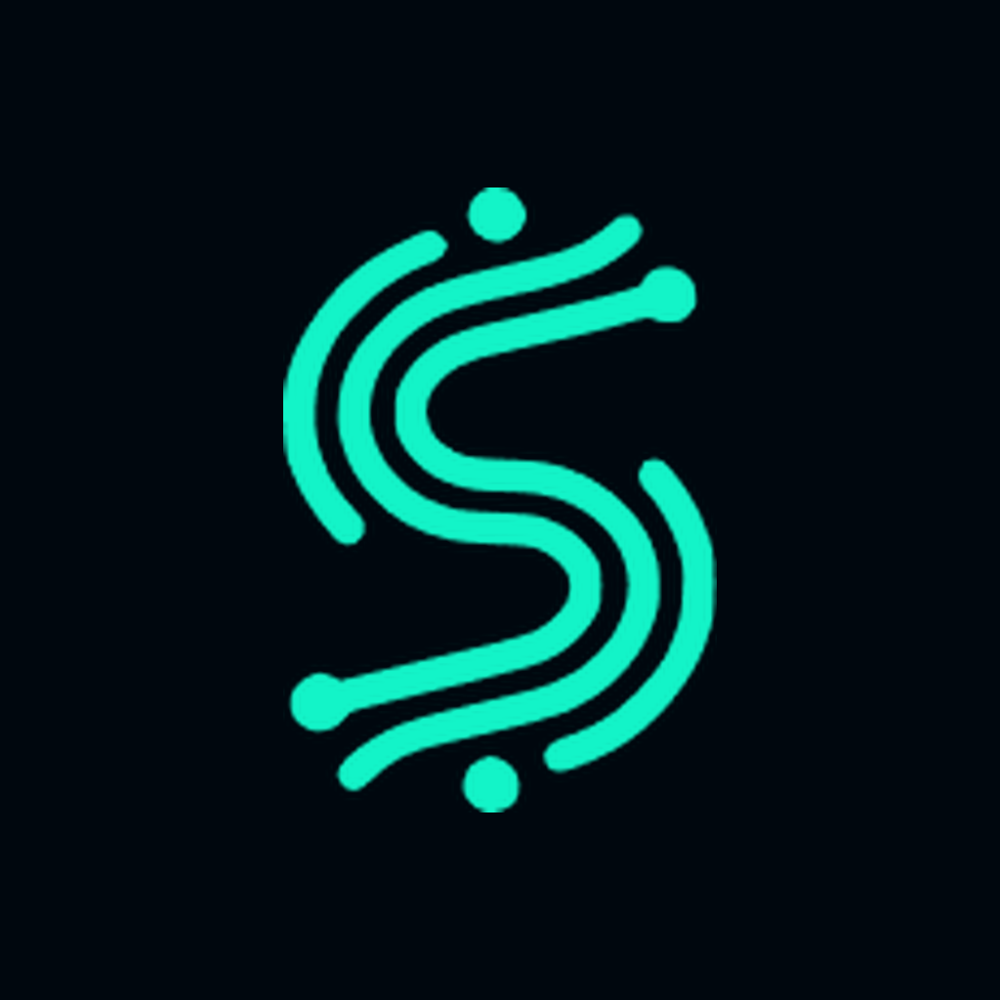

<p align="center">
  
</p>

<h1 align="center">Developer Skills for Claude Code</h1>

<p align="center">
  <i>How we work in 2026: AI, code and method</i><br><br>
  <b>Six Claude Code skills and five team agents we use on every project.</b><br>
  From ticket to release, with a method instead of guesswork.
</p>

<p align="center">
  
  
  
</p>

---

AI writes code faster than anyone. **Writing it is no longer the hard part**:
the hard part is knowing what to ask for, checking what it did, and shipping it clean.

These skills are our method, written so that Claude Code follows it on its own.
They are not magic prompts. They are the rules we learned by getting things
wrong: every line comes from a real defect.

## The method in four steps

```
  ticket ──▶ 01 PLAN ──▶ 02 TEAM ──▶ 03 VERIFY ──▶ 04 DELIVER
              │            │            │               │
          start-work    squadra    verify-for-real    deliver
                                   gui-test
                                   figma-check
```

| | Skill | What it does | Why |
|---|---|---|---|
| 01 | [`start-work`](skills/start-work/SKILL.md) | Reads the cards and **their comments**, writes a plan and **stops** to wait for the go-ahead. Then development, tests, audit rounds, report. | Without a plan, AI gives you random code. |
| 02 | [`squadra`](skills/squadra/SKILL.md) | A team of agents with separate roles (analyst, developer, reviewer, tester, approver) around a shared board, with gates. | Whoever writes the code must not be the one who checks it. |
| 03 | [`verify-for-real`](skills/verify-for-real/SKILL.md) | Break the fix and watch the test fail. Inject the fault instead of deducing it. Count instead of estimating. | When AI says "done!", it isn't true until you see it. |
| 03 | [`gui-test`](skills/gui-test/SKILL.md) | Drives the iOS simulator with idb: finds elements by label, taps, scrolls, types, captures. Script included. | A screen isn't verified until someone has looked at it. |
| 03 | [`figma-check`](skills/figma-check/SKILL.md) | Downloads node and render from Figma and compares them with the real screen, measurements included. | Text, sizes and order. Not the general impression. |
| 04 | [`deliver`](skills/deliver/SKILL.md) | Turns a dirty tree into disjoint, readable commits. Never pushes unless you say so. | Work is finished when it reaches the client, not when it compiles. |

## Installation

**As a plugin** (recommended), inside Claude Code:

```
/plugin marketplace add Spaghetticoders/developer-skills
/plugin install metodo@spaghetticoders
```

The skills are invoked as `/metodo:start-work`, `/metodo:squadra` and so on.
Claude also uses them on its own when the task calls for it.

**Or by hand**, copying skills and agents into your personal folders:

```sh
git clone https://github.com/Spaghetticoders/developer-skills.git
cp -R developer-skills/skills/* ~/.claude/skills/
cp developer-skills/agents/*.md ~/.claude/agents/
```

## How to use it, in practice

```
/metodo:start-work PROJ-142 PROJ-143
```

1. Claude reads both cards and their comments, looks at the code, and presents a plan.
2. **It stops.** You read, correct, and give the go-ahead.
3. It develops in slices. Every slice goes through the tests and the simulator
   (`gui-test`), and through the Figma comparison when there is a design (`figma-check`).
4. Every fix goes through `verify-for-real`: break it, watch the test fail,
   restore it.
5. Audit rounds until a whole round finds only cosmetic issues.
6. Final report. You ask for the commit, with `deliver`.

For big jobs, `squadra` sets up a team of agents that pass the baton to each
other, with a fresh approver at the end who can send everything back.

## The team agents

`squadra` spawns one agent per role. Each comes with its tools already cut to
fit, so "whoever writes doesn't check" is enforced by permissions, not by memory.

| Agent | Role | Can write |
|---|---|---|
| [`analyst`](agents/analyst.md) | Enumerates every use case and finds the holes in the logic | No |
| [`pixel-perfect`](agents/pixel-perfect.md) | Compares every screen with its Figma node, with veto power | No |
| [`reviewer`](agents/reviewer.md) | Writes the unit tests and proves each fix with `verify-for-real` | Tests only |
| [`tester`](agents/tester.md) | Runs every use case, on the simulator when it's UI | No |
| [`approver`](agents/approver.md) | Fresh eyes on the whole diff: APPROVED or ITERATE | No |

The developer is a regular `general-purpose` agent. With the plugin installed
the agents are available as `metodo:analyst`, `metodo:reviewer` and so on.

## Requirements

- [Claude Code](https://claude.com/claude-code)
- For `squadra`: agent teams enabled, `CLAUDE_CODE_EXPERIMENTAL_AGENT_TEAMS=1`
- For `gui-test`: macOS, Xcode and [idb](https://fbidb.io)
  (`brew tap facebook/fb && brew install idb-companion`, `pip install fb-idb`)
- For `figma-check`: a Figma personal access token in `FIGMA_TOKEN`

The examples talk about Flutter and iOS because that's what we do every day, but
`start-work`, `squadra`, `verify-for-real` and `deliver` work for any stack.

## The rules behind it all

- **Plan first, then code.** And in between, a human who says yes.
- **Whoever writes doesn't check.** Reviewer and tester are always someone else.
- **"Done" means verified.** A fix you haven't seen fail is not a fix.
- **No commits and no pushes unless you ask.** The repo history is yours.

## About us

<a href="https://www.spaghetticoders.it"><b>Spaghetti Coders</b></a> builds
Flutter apps, websites and digital products, with AI inside the method rather
than in place of it.

These skills are the gift from the live session **"Come si lavora nel 2026: AI,
codice e metodo"** (How we work in 2026: AI, code and method). If you use them
and improve them, open an issue or a pull request.

Got a project you want to grow? [Let's talk](https://www.spaghetticoders.it/spiegaciiltuoprogetto/).

## License

[MIT](LICENSE). Use them, change them, bring them to your team.
